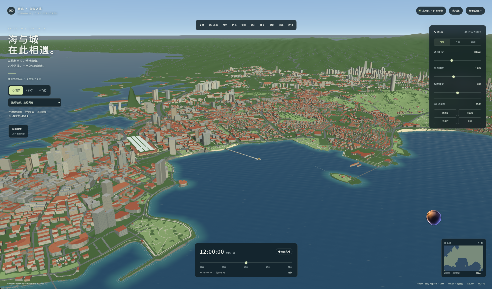

# 青岛 · 山海之城 Demo

Babylon.js + TypeScript + Havok 的浏览器游戏场景原型。覆盖市南、市北、李沧、崂山、城阳、黄岛、即墨、胶州，保留栈桥与青岛湾近景。真实 OSM 轮廓和 DEM 地形，1 单位 = 1 米。



*用户提供的场景截图，展示青岛湾、栈桥及老城区的整体布局；不是本轮更新后的验收截图。*

## 启动

Node.js 22.12+，本机以 Node.js 24 验证。

```powershell
npm install
npm run dev
```

打开 http://127.0.0.1:5173/ 。也可双击 start-demo.cmd。默认跟随当前北京时间；/?time=day 以明确标示的日间预览打开，可随时点“跟随实时”。

npm run build 执行 TypeScript 检查并构建，npm run preview 预览生产包，npm test 检查地理、高程、太阳与角色重力。

## Cloudflare Workers 部署

项目通过 `wrangler.jsonc` 将 `dist` 部署为 Workers Static Assets。这是浏览器端静态场景，不需要服务端入口或 `@cloudflare/vite-plugin`。提交 `wrangler.jsonc`、`package.json` 和 `package-lock.json` 后，Cloudflare Workers Builds 使用：

| 设置 | 值 |
| --- | --- |
| 根目录 | `zhanqiao-demo` 的仓库相对路径；若仓库本身就是该目录，留空或填 `/` |
| 构建命令 | `npm run build` |
| 部署命令 | `npx wrangler deploy` |
| Worker 名称 | `tsingtao-3d`，与配置和控制台项目保持一致 |
| Node.js | `24`，或其他满足依赖要求的版本 |

本地首次安装执行 `npm ci`，再执行 `npm run build` 和 `npm run deploy:check`。后者只检查和打包，不上传或发布。实际从本地部署使用 `npm run deploy`，需先登录正确的 Cloudflare 账户。

如果日志再次出现自动安装 `@cloudflare/vite-plugin` 或 `Cannot modify Vite config`，说明部署所在提交/根目录没有读到这份 `wrangler.jsonc`；检查推送的提交和 Cloudflare 根目录。不要只重跑尚未包含配置的旧提交。参考 [Cloudflare 静态资源配置](https://developers.cloudflare.com/workers/static-assets/binding/)。

线上遇到长期加载、200响应后连接关闭、扩展重发提示时，见 [加载故障分析与恢复机制](docs/deployment-loading.md)。v0.4.3构建时自动把基础地图、高程、区域大文件和Havok压缩为最多32 KiB的小块，4路并发下载，失败只重试相应分块；无需另运行数据脚本。观景与飞行先启动，区域细节与步行碰撞在后台准备，失败可单独补载。首页即使脚本未下载完也会显示启动状态和加载详情。

v0.4.5起将大型JavaScript程序也纳入分块交付：浏览器下载Worker在首次访问接管前等待就绪，校验并恢复原模块响应，成功片段和程序可跨刷新复用。v0.4.6将下载器接管等待上限调整为60秒，适应线上实测超过20秒的小文件请求。开发模式保持原生Vite加载，生产构建自动生成全部资源，无需另配Cloudflare服务端代码。架构、恢复策略、缓存边界与网络限制见 [启动架构分析](docs/loading-architecture.md)。发布后执行 `npm run check:live -- https://tsingtao.cupgis.cn/` 检查实际线上清单与所有程序分块；本地构建通过不代表线上验收通过。

v0.5.0改为渐进启动：HTML内置约17 KiB（gzip，含样式与简化OSM/DEM几何）的独立WebGL场景，无需等待Babylon即可拖拽、旋转、缩放。完整程序先在后台下载、校验、缓存，再执行原生模块；网络中断按3/6/12/24/30秒退避重试，恢复联网或点击按钮可提前重试。地图、高程与后续城市细节失败也会自动补载，完整场景接替时保留当前视角。轻量场景只提供观景，步行和完整光照效果等待正式场景。

## 已实现

- 回澜阁、栈桥与海浪组成的网站图标，提供含16/32/48/64/128/256像素的`favicon.ico`、SVG、32像素PNG及180像素触屏图标，仅用于浏览器图标和触屏书签，页面内不展示。
- v0.4.4隔离启动脚本与三维引擎，构建时检查入口全部静态依赖，禁止提前依赖Babylon并限制在24 KiB内，防止小入口因隐含大依赖无法执行。资源下载失败显示重试及具体阶段。
- v0.4：著名地物浮动标签，点击导航；控制面板可显示/隐藏标签、收起面板，顶部“光与海”可重新展开。
- 11处真实沙滩轮廓、湿沙坡面、细沙纹理、岸边礁石，以及与地形和碰撞的衔接。
- 细化信号山玻璃球楼、总督府石材与屋面、啤酒博物馆砖墙和窗格；新增透空钢结构电视塔、30m高“五月的风”、真实广场铺装与弧形市政府主楼。
- OSM地铁8条线路的移动光带；夜间城市暖窗、栈桥灯具、地标灯带，以及沿海高楼交替循环灯光秀。光效为视觉模拟，未接入实况，地铁数据不能作为最新运营范围依据。
- 常驻远景建筑与完整区域分组切换，避免高空建筑全部隐藏；连续滚轮保留地理锚点、排除重叠道路，并稳定阴影与远景窗格。新资产、来源和估算边界见 [v0.4说明](docs/rendering-v04.md)。

- 八个区市的行政导航、真实山地与海湾，镜头在目标间平滑过渡。
- 回澜阁和青岛站依据实景、建筑资料及 OSM 单独复原：黄色双层八角飞檐、24柱与窗格彩绘；现代青岛站黄墙红瓦、花岗岩饰面、拱门、半木构山墙、钟楼与翼楼。新增“青岛站”近景导航。资料、已知尺度与照片估算见 [public/data/LANDMARKS.md](public/data/LANDMARKS.md)。
- 新增胶州湾大桥真实双幅线路、海上互通和三种航道桥；信号山三座红球观景楼、小鱼山三层绿瓦览潮阁、总督府与迎宾馆、登州路啤酒博物馆、海大鱼山校区历史楼群、大学路鱼山路红墙。地标导航包含19个目标，米制地理坐标保留。参考与估算界限见 [public/data/CITY-LANDMARKS.md](public/data/CITY-LANDMARKS.md)。
- 全域400米DEM网格，旧城6.4×6.4公里使用32米网格，浮山4.8×4.4公里使用40米网格，崂山新增80米网格，最高采样点1091.74米；地形没有垂直夸张，网格间距不代表测绘精度。
- 栈桥附近约4250栋建筑、2339条道路，500米街区合批。全域23758栋建筑组织为1762个2公里分块，按镜头位置逐步加载，并保留有限缓存。旧城区使用赤瓦、柔和立面和绿树。
- 远景使用简化主道路，细节道路贴地分层；对数深度、深度偏移、mipmap、FXAA降低缩放闪烁。近景仅提交当前焦点附近的阴影，大桥按地理范围裁剪，远海细浪及栈桥反射随距离简化。远处关闭标线、细栏杆和小路，高空不加载细建筑。
- 独立GLSL波浪、细浪法线、菲涅耳反射、栈桥倒影、区域/近岸泡沫。真实OSM陆海mask保留海湾和岛屿。
- UTC+8实时太阳/月亮位置、晨昏、夜空，全天预览、海面参数和节能画质。

观景：左键拖拽地图、右键旋转、滚轮围绕鼠标位置平滑缩放。步行：WASD、Shift、Space；飞行：WASD、Q下降、E上升、Shift加速，速度随高度提高。桌面点击画面锁定鼠标，Esc退出。

步行Havok碰撞覆盖栈桥与周边详细区域，在后台准备完成后启用；准备期间可先观景和飞行。全域目前使用自由飞行/观景。没有飞机动力学或全域动态碰撞流送。手机可触摸平移、双指缩放观景，键盘步行/飞行以桌面为目标。

## 数据与精度

原点120.3163°E、36.0603°N，WGS84 AEQD投影；X东、Z北、Y上。DataV边界GCJ-02先逆变换再投影；行政边界概化，陆海裁切采用OSM海岸。

```text
+proj=aeqd +lat_0=36.0603 +lon_0=120.3163 +datum=WGS84 +units=m +no_defs
```

区域运行范围约140×117公里。地形取真实DEM，一般陆地最低渲染高程2.4米是与波浪分离的视觉处理，实际沙滩湿岸例外。400米网格会丢失小山脊；DEM不能视为测绘路面。后续可增加更细地形LOD、地理分块碰撞和浮动原点。

栈桥OSM外轮廓主轴约405.55米，主体约8米宽，保留源几何；介绍资料常见440米的定义不同。桥面海拔约4米；回澜阁与青岛站为资料及实景驱动的参数化复原，未取得施工图的细尺寸仍为估算。区域321栋建筑具有height，5084栋按楼层估计，18353栋按类型估计；无OSM轮廓处不虚构建筑。部分仅由relation表达的建筑可能缺失。

局部OSM下载于2026-10-12，区域Geofabrik山东PBF日期2026-10-11。完整来源、估计标记、许可、DEM编码与schema见 [public/data/SOURCES.md](public/data/SOURCES.md)。原始PBF、DEM瓦片、OSM缓存保存在本地sources/，不进入发布资源或Git；站点提供派生运行数据和来源记录。

数据脚本（按需执行，优先本地缓存）：

```powershell
python scripts/fetch-osm.py
python scripts/fetch-region.py
python scripts/extract-regional-osm.py
python scripts/build-regional-shore.py
python scripts/extract-heritage.py
python scripts/extract-bay-bridge.py
python scripts/refine-landmark-terrain.py
```

Python需requests、numpy、Pillow、shapely、pyproj、scipy、osmium，OSM依赖见scripts/regional-osm-requirements.txt；重新获取前备份对应sources/缓存。

## 扩展入口

- src/world.ts：栈桥、局部建筑/道路、公园、地标集成、近景LOD与碰撞。
- src/pavilion.ts、src/station.ts：回澜阁和青岛站独立建筑几何、纹理、坐标与碰撞；模型参考见 docs/ 与 public/data/LANDMARKS.md。
- src/map-controls.ts：按地理平面拖拽、鼠标锚点平滑缩放与防误点击。
- src/bay-bridge.ts、src/heritage-buildings.ts、src/hill-parks.ts、src/fushan.ts：独立米制地标和距离裁剪。
- src/terrain.ts、src/height.ts：真实高程、米制采样、宏观/精细地形和陆海裁切。
- src/regional.ts：主道路、地理建筑分块加载和缓存。
- src/ocean.ts：海面shader、反射与海岸距离。
- src/solar.ts：绝对时间和UTC+8太阳/月亮计算。
- src/main.ts：相机、物理、导航、光照与界面。

本版无需Blender，模型由参数化几何生成。后续可用米制glTF/GLB替换地标，保留同一地理锚点。海浪、潮位、天气、补光是视觉表现，未接实测海况；未含车辆、人物AI、室内和交通。

## 验证与许可

50项测试覆盖启动依赖图、Worker接管/更新时序、程序分块与持久缓存、程序SHA-256校验、完整响应体超时/中断、分块重试与复用、4路并发限制、二进制无损解压，以及左右键交互、连续滚轮锚点、拖动后防误点击、远景替换连续性、沙滩坡面与远景材质、博物馆地坪、阴影像素对齐、电视塔与雕塑尺寸/重复模型排除/外法线、地铁数据、三种航道桥、地标位置、八区数据、高程、UTC+8太阳与角色重力。浏览器检查昼夜、地标、山地、地铁光效及标签和面板开关。FPS依赖设备及硬件加速，界面实时显示。

地图数据 © OpenStreetMap contributors，ODbL1.0。DEM为AWS/Mapzen Terrain Tiles，上游归属见来源文档。依赖和海面参考见THIRD_PARTY.md。静态包包含运行资源，无地图API密钥。
