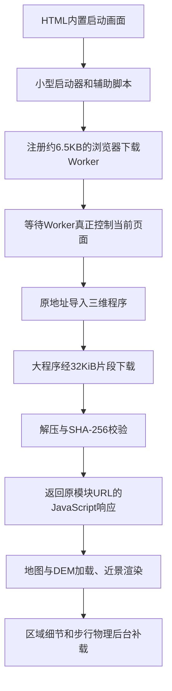
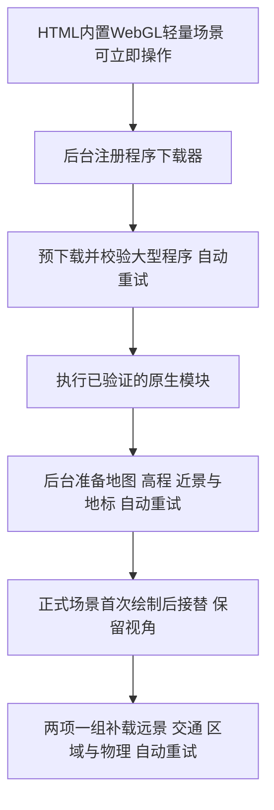

# 启动与资源交付架构（v0.5.0）

## 线上故障与证据

已发布的v0.4.4确实修复了启动器静态依赖大引擎的问题，但引擎本身仍是一个1,825,756字节的原生ES模块。线上请求曾返回200及Brotli响应头，只收到81,920字节后读取超时；另一次请求在获取响应头时超时。与此同时，入口、1,110字节的辅助脚本、206,486字节的主程序和14,077字节的CSS可以完整下载。线上实际清单引用的32 KiB地图片段及区域索引片段也完整返回200，分别约5秒和8秒。

这些记录说明当前交付方式对大响应的中断恢复不足，不能据此认定是哪个运营商、代理或Cloudflare节点主动关闭连接。探测中Windows本地生成的旧分块路径曾返回404；它不是线上程序所引用的路径，不能把该404当作线上故障原因。诊断必须读取当次发布的清单，不能猜资源哈希。

此前只分块JSON/DEM/WASM，没覆盖JavaScript，因而仅补日志和重试数据无法解决引擎请求失败。

## v0.4.5–0.4.6的交付实现



这是浏览器Service Worker，不是新增Cloudflare服务端Worker。现有Wrangler静态资源配置保持不变。

| 层 | 代码 | 职责 |
| --- | --- | --- |
| 启动与状态 | `src/bootstrap.ts`、`src/module-delivery.ts`、`src/startup-ui.ts` | 小启动器先执行，等待控制权，展示进度与失败资源 |
| 通用传输 | `src/asset-loader.ts` | 4路并发、整段读取超时、重试、长度与gzip验证；可接入持久片段缓存 |
| 程序交付 | `worker/module-worker.ts` | 只接管清单内、同源、GET的大型程序URL；校验源码SHA-256并以JavaScript MIME返回，保留原生相对导入语义 |
| 生产构建 | `scripts/module-delivery.mjs`、`scripts/asset-chunks.mjs`、`scripts/startup-graph.mjs` | 生成片段、清单和下载Worker，限制启动依赖预算 |
| 场景 | `src/main.ts`及现有世界/地形模块 | 继续负责三维内容、交互和分层显示，不与下载Worker耦合 |
| 发布验收 | `scripts/check-deployment.mjs` | 从线上HTML和实际发布清单读取资源，检查版本一致、片段完整和程序摘要 |

生产包中Babylon约430 KiB的gzip内容拆为14块，主程序拆为3块；压缩及分块不删减模型或地理数据。原始ES模块仍保留给标准加载回退使用。

## 恢复、缓存与更新

- 每个片段最多32 KiB、最多两次尝试，每次30秒；成功片段不会因另一个失败而重新下载。
- 成功片段存入本站专用Cache Storage，页面刷新或Worker重启后仍可复用；完整程序校验后另行缓存。片段缓存上限512项，完整程序上限16项；存储不可用时保留内存下载能力。
- 引擎、主程序仍以原始URL导入，无`eval`、Blob模块地址改写或跨站镜像，避免破坏相对依赖与模块执行语义。
- 第一次访问也必须等待`clients.claim()`后的实际控制权；仅完成`register()`不够。下载器URL包含源码/数据/依赖及压缩运行时的构建指纹。同版本重新构建时等待该指纹对应的新Worker实例激活并接管，监听稍后发生的updatefound，不能看到旧active就立即继续。
- Worker和清单不配置永久缓存；HTML使用no-cache。带哈希的原始程序和片段使用immutable缓存。
- Worker不接管HTML、接口、POST、其他域名、地图分块或不在清单中的文件；应用网络接口不会进入这套缓存。
- 开发模式不注册Worker，保留Vite热更新。不支持Service Worker/流解压或注册失败时明确回退标准加载；这种回退仍受原大文件链路影响。

实现依据：[FetchEvent.respondWith](https://developer.mozilla.org/en-US/docs/Web/API/FetchEvent/respondWith)、[Service Worker Clients](https://developer.mozilla.org/en-US/docs/Web/API/ServiceWorkerGlobalScope/clients)。

## 验证方式

生产包浏览器故障模拟：服务器拒绝完整Babylon和主程序URL，并在首个引擎片段返回200后截断正文。页面仍通过分块进入场景，直接完整程序请求为0次；受损片段请求2次，其余16片各1次。后台完成5/5，Havok启用，无未捕获的应用错误。刷新后程序片段新增下载0次。测试产物位于本地忽略目录`artifacts/`。

```powershell
npm test
npm run build
npm run deploy:check
npm run check:live -- https://tsingtao.cupgis.cn/
```

`check:live`检查入口、辅助脚本、下载Worker及全部程序片段，并核对HTML/清单/Worker版本内容与SHA-256，报告保存在`artifacts/deployment-check.json`；它不替代浏览器渲染验收。使用环境代理的Node.js 24环境可执行：`node --use-env-proxy scripts/check-deployment.mjs https://tsingtao.cupgis.cn/`。

修复前的线上基线是v0.4.4，没有v0.4.5的module-delivery.json。该文件当时返回404是“新版尚未发布”的证据，不是旧版自身加载失败的原因。本机Wrangler未认证；发布走GitHub main分支已有的Cloudflare自动构建流程，发布结果须以线上版本、分块完整性及浏览器验收为准。

## 优化边界

本轮优化的是失败恢复与重复访问成本，不声称减少首次进入所需的全部字节或消除基础网络问题。Worker脚本和小启动器仍需先下载；所有链路都不可用时，前端无法凭空恢复资源。PNG地形/海岸纹理也仍走普通图片路径。

`main.ts`仍集中管理场景系统，后续可继续拆分场景上下文、导航/时间/物理系统，以及优先栈桥近景再构建远处地标。这样做需要同步处理建筑排除ID、地形采样和碰撞依赖，不能只把构造函数改成异步，否则会出现重复建筑、悬空模型或碰撞缺失。本轮保留这些已验证关系，先处理已有证据指向的程序交付断点。

## v0.4.6线上等待边界

v0.4.5已经通过GitHub main自动发布。线上下载器6503字节的一次请求耗时约26秒，超过原20秒接管等待上限；该上限可能使慢网络回退到整包下载。v0.4.6延长到60秒，同时保留20秒的等待提示与重试入口。新增模拟26秒后才完成注册的测试，要求在下载器接管前继续等待；测试总计45项。线上验收中还出现单个32 KiB分块两次连接失败、随后复测成功，说明分块可恢复传输，但不能承诺网络不再失败。

## v0.5.0：先进入轻量场景，再补齐正式场景

仅缩短入口并不能让用户在引擎下载失败时看到城市。新版增加独立的HTML内置WebGL渲染器：构建时从现有OSM提取海岸、栈桥完整轮廓和最多100栋简化建筑，从DEM提取简化地势；沿用原点及米制坐标。回澜阁是低细节替身，建筑为真实轮廓包围盒，不能作为精细地标模型。连同完整样式的HTML约17 KiB gzip，构建限制24 KiB gzip。它没有外部模块依赖，也不依赖Service Worker。正式程序故障不会再阻止观景。



原生ES模块下载失败后，浏览器会在当前页面记住失败的模块记录。现在下载器先通过消息协议准备所有大程序，失败时不调用import；网络恢复后从成功片段继续，再导入已校验缓存的程序。该方法避免把临时网络失败过早送入模块执行阶段。生产样式内联到HTML，避免另一个CSS请求挡住动态导入。开发模式仍使用Vite正常模块加载。

资源恢复使用3、6、12、24、30秒的退避，上限30秒；恢复联网或点击“立即重试后台下载”会唤醒等待。地图/高程只对明确的下载异常自动恢复，永久404及模型程序错误保留明确报错，不无限吞掉错误。后续城市任务每次最多启动两项，已完成项不再执行。完整程序/地图缺失期间，保留轻量场景的相机交互。正式画面接替时读取轻量画面最新相机，停止轻量渲染循环并释放WebGL上下文。

Babylon.js是完整场景的渲染库，不是城市模型文件；当前引擎原始JavaScript约1.83 MB，gzip约430 KiB。Havok是另一个步行碰撞物理库，WASM原始约2.09 MB、gzip约649 KiB，在正式场景可观景后后台加载。文件较小仍可能慢：线上曾出现200响应声明14841字节、实际仅收8192字节后停止，以及小脚本等待26秒。主要等待包含建连、首字节、正文中断及超时重试，无法据此单独归责于Cloudflare或某个网络提供方。

边界：HTML本身仍需要网络成功返回；未启用WebGL的浏览器无法渲染三维；轻量场景只支持观景，完整地标、夜景、八区数据和步行由正式场景接替。这里并未更换引擎，也未把简化地标当成最终模型。

生产包故障验收：所有外部资源返回503时，内置轻量场景仍渲染且拖拽、缩放改变相机；程序分块连续失败时自动退避，恢复程序后继续加载地图；地图恢复后无需刷新进入正式场景，前后target/radius/alpha/beta一致，后台5/5完成、Havok启用。正式场景恢复后无应用错误。50项测试、生产构建及Wrangler部署预检通过。验收图片和请求记录保存在忽略目录artifacts/，不能把本地故障模拟等同于线上链路稳定性证明。
