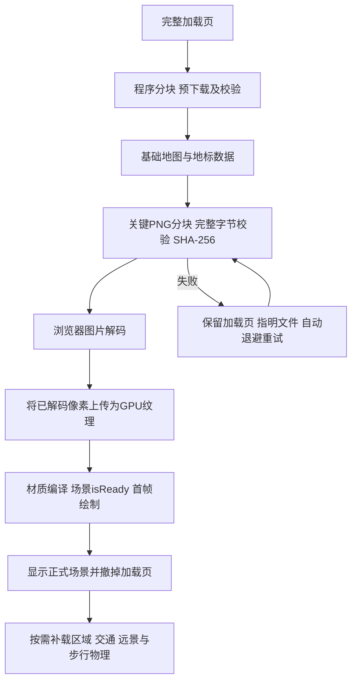

# v0.5.2–0.5.3 红黑棋盘与加载失败根因分析

## 能确定的结论

截图中建筑、标签、相机、Havok和帧率已经工作，说明Babylon渲染程序已经执行。红黑棋盘是失败纹理的默认占位图，不是“引擎尚未下载”的证据。安装版本8.56.2的`Misc/tools.js`提供该内置占位图，`Engines/abstractEngine.js`在图片加载错误时启用回退。

在原v0.5.1生产包中仅阻断`/data/*.png`，其余程序/JSON/DEM/WASM正常返回，即可复现同样的棋盘；加载页已被撤除。复现截图保存在忽略目录`artifacts/textures-before-checkerboard.png`。

项目缺陷由两部分共同造成：

1. 之前给程序、地图、高程和WASM添加分块下载，却遗漏PNG。`terrain.ts`和`ocean.ts`直接创建网络Texture，失败后没有应用级重试或完整性验证。
2. `main.ts`在第一次`scene.render()`后立即删除加载页，没有确认关键纹理解码、GPU上传和材质准备完成。引擎默认占位图让损坏画面继续以高帧率显示。

这是加载管理缺陷，不能通过增加等待文字或隐藏错误颜色解决。

## 线上交付对照

本机同一轮HTTP探测结果，原始记录在`artifacts/live-texture-diagnosis.json`：

| 当前域名资源 | HTTP | 声明字节数 | 本次实际收到 | 结果 |
| --- | --- | ---: | ---: | --- |
| terrain-palette.png | 200 | 838412 | 65536 | 正文读取超时 |
| detailTerrain-palette.png | 200 | 88393 | 0 | 正文读取超时 |
| regional-land-mask.png | 200 | 38196 | 24576 | 正文读取超时 |
| shore-distance.png | 200 | 87677 | 73728 | 正文读取超时 |

同一个已提交的`terrain-palette.png`通过GitHub raw下载，2.1秒收到全部838412字节，SHA-256与本地一致。对照记录在`artifacts/texture-delivery-control.json`。原文件并未损坏，问题集中在当前域名的资源交付路径；响应头200或Cloudflare缓存HIT不代表正文已完整到达。

这些测试来自本机，不能替代用户所在运营商的测试。也不能仅由它们判定Cloudflare服务端存在bug，或把本机测试出口视为用户实际访问节点。区分Cloudflare边缘、代理、运营商链路或传输协议，需要结合具体失败请求的CF-Ray、时间、接收字节数及其他网络的对照。部署检查脚本现在保留失败请求的这些字段。

## 修复与加载屏障

- `scripts/asset-chunks.mjs`把数据引用的7张PNG加入分块清单；生产初始化实际必需5张。生成`image-delivery.json`用于发布验收，构建指纹包含PNG源文件。
- `src/image-resources.ts`使用现有下载通道取回字节，验证PNG签名和构建SHA-256，再从本地Blob解码。已成功的图片和分块可复用，校验失败清理相应片段。
- `src/managed-textures.ts`把解码完成的HTMLImageElement交给Babylon，不让Texture重新请求原PNG。不同材质仍拥有独立UV设置；真实GPU上传错误会使就绪屏障失败。
- `main.ts`等关键图片、上传及`scene.isReady()`完成后才显示画面。关闭默认错误纹理回退是防御措施；真正修复是受控传输与就绪屏障，并非把棋盘换成另一张占位图。
- 默认取消轻量预览；加载页列出实际阶段和资源路径，失败自动退避，联网恢复或点击按钮可提前重试。图片无法解码、GPU上传失败或编译不就绪不会被算作加载成功。
- `check:live`增加全部PNG片段、原始字节数、签名和SHA-256核对；浏览器验收另外覆盖解码、上传和显示时机。

## 是否需要换成Three.js

本次没有引擎渲染失败的证据。Three.js可以用于这个场景，但其纹理加载同样依赖图片传输，`TextureLoader`内部调用`ImageLoader`并提供加载/错误回调。相同图片未完整下载，换引擎也不能补齐丢失字节。具体项目的首包大小取决于所用功能和打包，不能用空场景的体积替代当前城市、阴影、海面和物理功能的对等比较。

现有模型生成、材质、海面Shader、地形、LOD、交互和Havok控制器均使用Babylon接口。迁移需适配这些系统并重新验证，不是替换一个依赖。应先修复可复现的加载管理缺陷，独立评估托管链路，再按功能或性能需求决定是否迁移。

依据：[Babylon官方社区关于错误纹理的说明](https://forum.babylonjs.com/t/event-trigger-when-texture-does-not-load/24042)、[Three.js官方TextureLoader实现](https://github.com/mrdoob/three.js/blob/dev/src/loaders/TextureLoader.js)。

## 验证

53项测试通过，覆盖PNG无损分块、摘要、HTML冒充图片、截断及等长损坏、成功解码复用、失败可重试、不同UV共享像素、GPU上传失败拒绝就绪，以及原有程序与地理测试。

生产包浏览器中持续阻断一个地形PNG片段：保持完整加载页，关键图片4/5，canvas不可见。恢复片段后无需刷新，关键图片5/5，GPU与材质就绪后进入正常场景，后台5/5、Havok启用，无应用错误。测试期间所有原PNG URL始终返回503；页面原PNG GET次数为0，证明使用了受控像素通道。证据图片为`artifacts/textures-after-loading.png`、`artifacts/textures-after-recovered.png`，请求记录为`artifacts/qa-texture-after-final-counts.json`。

本地故障恢复成功不等于线上链路故障消失；若小片段也持续无法传输，应从静态资源交付/网络侧排查，而不是继续修改引擎。

## v0.5.3：主交付线路失败时的受控备用源

线上分块复测中，6张图片可以在重试后完成，第7张大图的个别32 KiB片段仍反复中断。原始报告保存在artifacts/live-image-integrity.json，保留了CF-Ray和实际收到的字节数。这说明仅把大请求切小，仍无法保证这条访问线路稳定。

增加应急图片源：构建时读取当前Git提交，将同仓库`public/data/*.png`的不可变raw地址写入交付清单；只在主通道下载/验证失败后尝试，不额外获取成功图片。客户端只接受指定仓库、40位提交ID及PNG路径，每次下载仍须匹配原PNG的SHA-256及签名；错误内容不会送入解码/上传。两条线路都失败时保留加载页并退避重试，不把失败当成功。

不下载或执行备用站点的JavaScript。备用GitHub源有自己的可用性边界，应视为应急方案；这不是对任意地区网络的稳定性承诺，也不能替代托管侧排障。无Git元信息的源码副本不生成备用地址，仍保留主通道恢复能力。

浏览器故障验收中持续让地形纹理的最后一片返回503，5/5关键图片最终就绪；DOM记录terrain-palette.png来自backup，其余4张为primary，完整场景显示正常，后台5/5，无应用错误。证据为artifacts/textures-backup-recovered.png。55项测试通过，新增备用只在主失败时使用、备用数据仍受摘要约束及拒绝未知源的测试。
